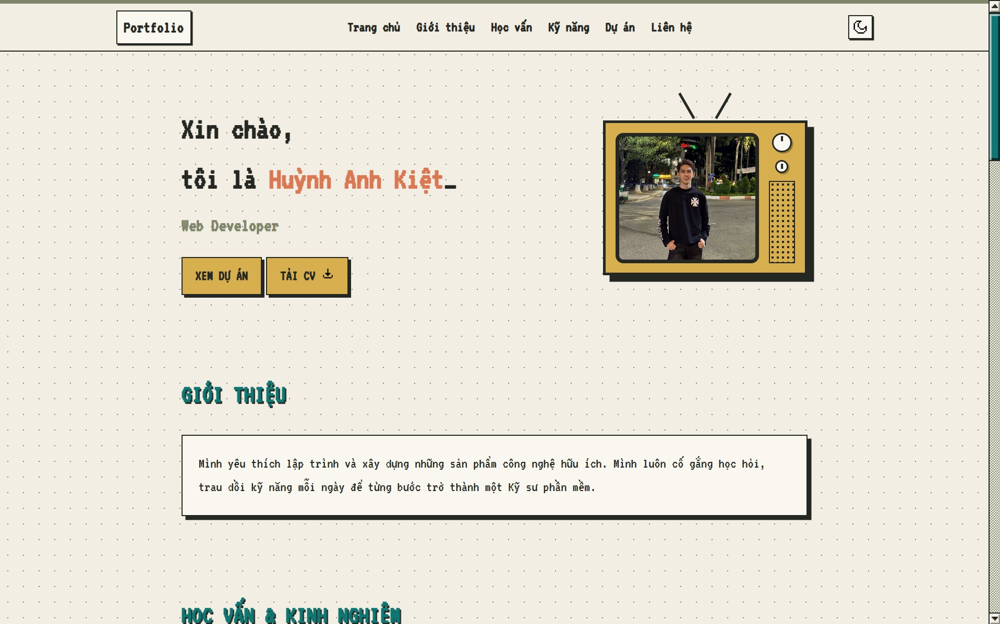

# Personal Portfolio Website - Huỳnh Anh Kiệt

Website Portfolio cá nhân mang phong cách **Retro / Pixel Art** hoài cổ (được truyền cảm hứng từ giao diện hệ điều hành cổ điển và game 8-bit). Dự án giới thiệu về bản thân, kỹ năng lập trình, kinh nghiệm thực tiễn và các dự án cá nhân nổi bật.



---

## Tính năng nổi bật

- **Retro & Pixel Art Design:** Giao diện độc đáo với khung TV CRT nhấp nháy, font chữ VT323 hoài cổ, thanh cuộn Pixel Art 3D và các khối hiệu ứng Windows 95/Retro UI.
- **Dynamic Rendering (JSONP Architecture):** Tự động tải và hiển thị dữ liệu (Học vấn, Kinh nghiệm, Kỹ năng, Dự án, Giải thưởng, Sở thích) từ file cấu hình `js/portfolio-data.js` giúp dễ dàng cập nhật thông tin mà không cần chỉnh sửa HTML.
- **Dark Mode / Light Mode Toggle:** Hỗ trợ chuyển đổi giao diện Sáng / Tối linh hoạt, lưu trạng thái lựa chọn của người dùng qua `localStorage`.
- **Project Filter System:** Bộ lọc dự án thông minh theo danh mục (Tất cả, Web, App) mượt mà.
- **Responsive Design:** Tối ưu hiển thị tương thích trên nhiều kích thước màn hình từ Desktop đến Mobile với Hamburger Menu phong cách Pixel.
- **Interactive Contact Form:** Form liên hệ tích hợp kiểm tra dữ liệu đầu vào và gửi email trực tiếp qua trình duyệt (`mailto:` URI Scheme).

---

## Công nghệ sử dụng

- **HTML5:** Cấu trúc trang chuẩn Semantic & Accessibility (`aria-label`).
- **CSS3 / SASS:** Tùy biến biến CSS (CSS Variables), Flexbox, Grid, hiệu ứng Animations & Pixel Art Scrollbar custom.
- **Vanilla JavaScript (ES6+):** Xử lý logic render dữ liệu động, bộ lọc dự án, chuyển đổi Dark Mode, Tab Navigation và Form Validation.
- **Typography:** Google Font (`VT323`).

---

## Cấu trúc thư mục (Project Structure)

```text
website-portfolio/
├── assets/
│   ├── icons/          # Các biểu tượng SVG (external-link, download, mail, github...)
│   └── images/         # Ảnh đại diện, ảnh dự án, giấy chứng nhận
├── css/
│   └── style.css       # File CSS tổng hợp styling & giao diện Retro/Pixel
├── js/
│   ├── main.js         # Logic xử lý giao diện, render động và sự kiện DOM
│   └── portfolio-data.js # File lưu trữ dữ liệu JSONP cá nhân
├── docs/
│   └── resume.pdf      # File Resume/CV dùng để tải về
├── index.html          # Trang chủ chính
└── README.md           # Tài liệu hướng dẫn dự án
```

---

## Hướng dẫn chạy dự án

1. **Clone Repository về máy:**
   ```bash
   git clone https://github.com/anhkiet1210/website-portfolio.git
   ```

2. **Mở dự án:**
   - Truy cập vào thư mục vừa clone.
   - Mở trực tiếp file `index.html` trên bất kỳ trình duyệt web nào (Chrome, Edge, Firefox, Safari).
   - Hoặc mở bằng extension **Live Server** trong VS Code để có trải nghiệm xem thay đổi thời gian thực.

---

## Cách cập nhật nội dung

Để chỉnh sửa hoặc thêm mới Kỹ năng, Dự án, Học vấn hay Giải thưởng, bạn chỉ cần mở file `js/portfolio-data.js` và cập nhật thông tin trong đối tượng JavaScript:

```javascript
loadPortfolioData({
    "personalInfo": {
        "name": "Huỳnh Anh Kiệt",
        "title": "Web Developer",
        // ...
    },
    "skills": [ "HTML5", "CSS3", "JavaScript", ... ],
    // Thêm hoặc chỉnh sửa thông tin tại đây
});
```

---

## Liên hệ (Contact Information)

- **Họ và tên:** Huỳnh Anh Kiệt
- **Email:** [huynhanhkiet457@gmail.com](mailto:huynhanhkiet457@gmail.com)
- **GitHub:** [@anhkiet1210](https://github.com/anhkiet1210)
- **LinkedIn:** [huynhanhkiet123](https://www.linkedin.com/in/huynhanhkiet123)

---

*Built with ♥ in Retro Style.*